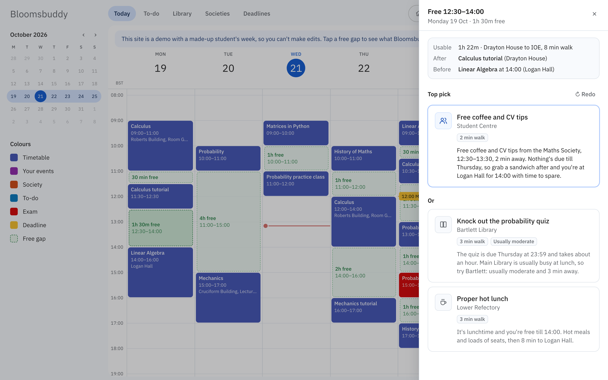
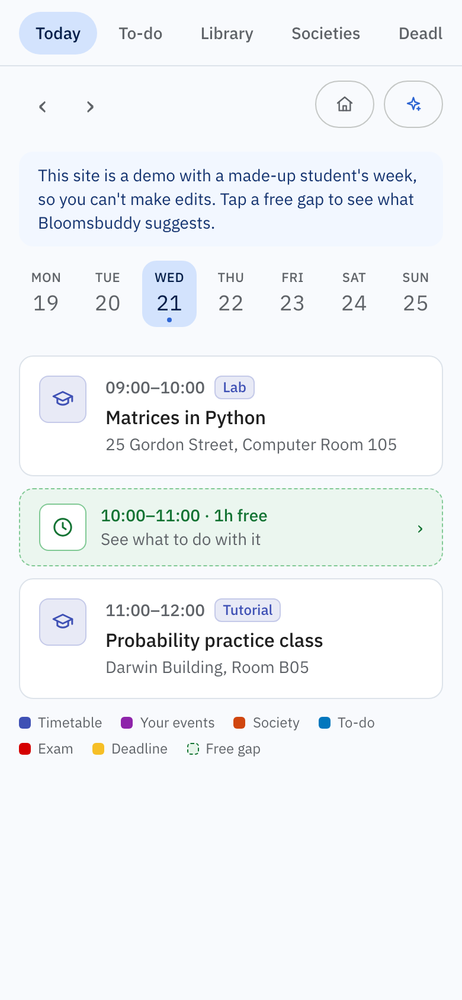
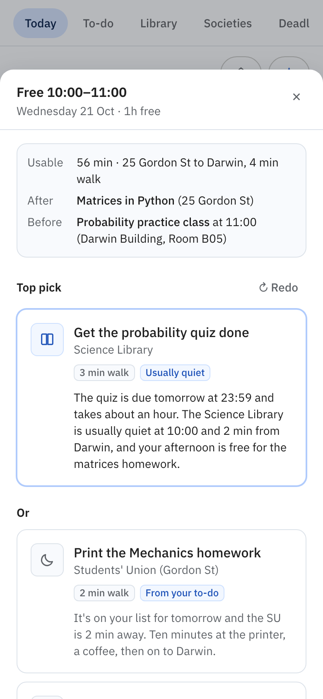
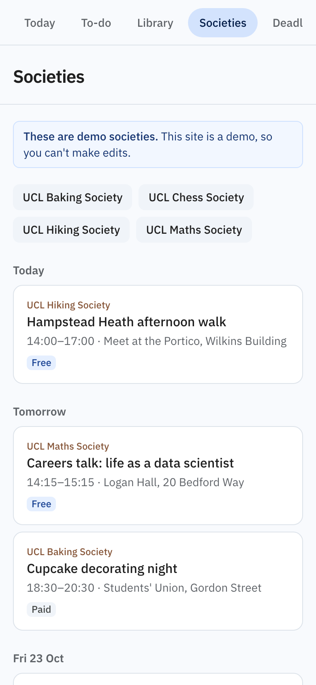
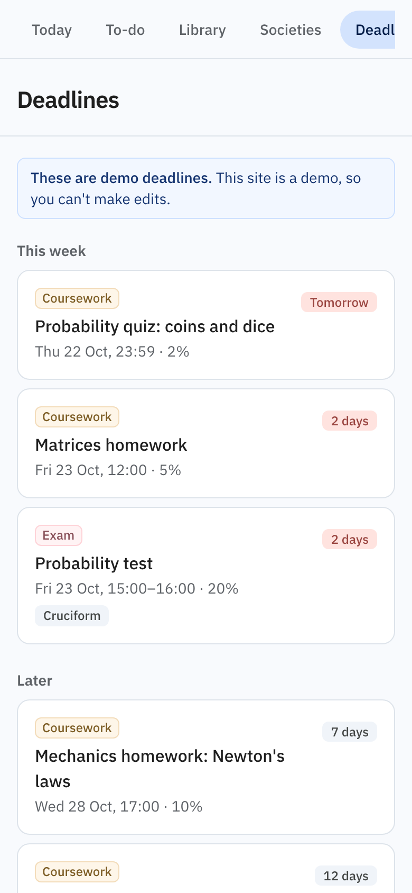
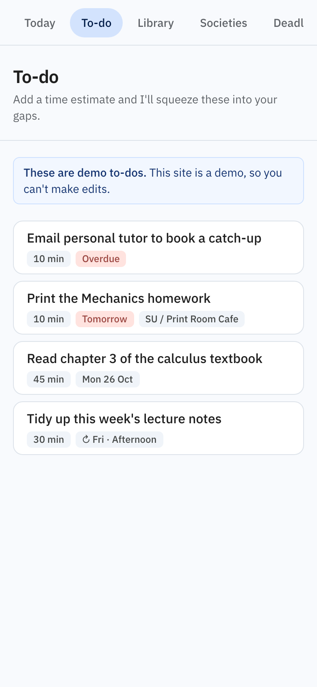

# Bloomsbuddy

Bloomsbuddy finds the free gaps between your UCL lectures and uses Claude to suggest the best thing to do in each one.

I built it for the UCL Claude Campus Hackathon (16 October 2026, Better Student Life track) and kept working on it afterwards.


[Watch it in full quality](bloomsbuddy-demo.mp4) (MP4, 14 MB)



## What it does

UCL timetables leave gaps between lectures, and most of that time gets wasted. Bloomsbuddy reads your timetable and Moodle deadlines from screenshots, finds the gaps, and gives you a top pick for each one plus two alternatives, each with a reason. A pick can be a study spot, a society event, lunch, a rest, going home, or something from your to-do list.

<p align="center">
  
  
</p>

To choose, Claude looks at:

- how much of the gap is left once you've walked from your last room and allowed time to reach the next one
- how busy each library is likely to be at that hour
- society events on during the gap, taken from the Students' Union website
- your deadlines and exams, ranked by how much slack you have left on each
- your to-do list, and whether each item fits in the gap
- your home, if you've set one (it only suggests going back when the round trip leaves you 30 minutes or more there)
- lunch, when the gap falls between 12:00 and 14:00 and you haven't had a chance to eat yet

Around that sits a full calendar:

- Week and day views in the style of Google Calendar, always Monday to Sunday
- Ask Bloomsbuddy, a chat for any time slot ("what can I do on Saturday from 14:00 to 17:00?") that can suggest events and to-dos for you to add
- Paste a society's SU page link to see its upcoming events and add them to your calendar
- To-dos (one-off or repeating), deadlines and exams, which can all go on the calendar
- Import a calendar from an `.ics` file
- A Library tab with UCL's live seat page

<p align="center">
  
  
  
</p>

Everything you add is saved in your browser. There's no account or login.

## How it works

The app is Next.js (App Router) with TypeScript and Tailwind. Claude only runs in server route handlers, through the Anthropic TypeScript SDK with `claude-sonnet-5-5`.

- Picks for a gap come from a tool-use loop. Claude calls tools such as `get_study_spaces`, `get_events_in_window`, `get_deadlines`, `get_todos` and `get_home`, each answering for that gap's time window, and returns its picks as JSON constrained by a schema. The server checks them too: a "go home" pick is only allowed when the round trip leaves at least 30 minutes at home.
- Screenshots of timetables, Moodle pages and to-do lists are read with Claude's vision into a fixed schema.
- The chat answers most questions in one Claude call. The next seven days of classes, free gaps, deadlines and to-dos go straight into a prompt-cached context, so a typical question costs about $0.004.
- Society events are scraped from each society's SU events page with cheerio, so they cost no API tokens.
- Walking times come from building coordinates in `lib/buildings.ts`. A private postcode is turned into coordinates with postcodes.io.
- Every data source sits behind a provider interface with a mock and a real version. If a real one fails, the app falls back to the mock and keeps working.
- All times are Europe/London, worked out with `Intl.DateTimeFormat`, because the server runs in UTC.

## What's real and what's estimated

- Library busyness is an estimate. It starts from one real seat count (a Tuesday at 11:40) and scales it by time of day and weekday. UCL's live seat page blocks requests from servers, so the app can show it in an iframe but can't read it.
- The food spots are placeholder data, with rough locations and made-up queue notes.
- Society events on your own week are real, fetched live from the SU site on every request.

## The demo week

The app opens on a demo week: a made-up maths student's timetable for 19 to 25 October 2026, with deadlines, to-dos and a home already filled in. Its picks were written in advance from the same tool data Claude sees, so the demo never calls Claude and costs nothing to show. It's read-only.

A production build (`npm run build`) only ever shows this demo. To use your own timetable, run the dev server.

## Run it locally

You need:

- [Node.js](https://nodejs.org) 20.9 or newer
- An Anthropic API key from [console.anthropic.com](https://console.anthropic.com) for the Claude features. Usage is billed to your account. Without a key the demo week still works, and the Claude features say Claude isn't connected.

1. Clone the repo and install the dependencies:

   ```bash
   git clone https://github.com/rufusgsmith/bloomsbuddy.git
   cd bloomsbuddy
   npm install
   ```

2. Copy the example env file:

   ```bash
   cp .env.example .env.local
   ```

   Open `.env.local` and paste your key after `ANTHROPIC_API_KEY=`. Git ignores `.env.local`, so your key stays on your machine. Never commit it.

3. Start the dev server:

   ```bash
   npm run dev
   ```

4. Open [http://localhost:3000](http://localhost:3000). It starts on the demo week. Tap "Set up my week" to add your own timetable.

## Project layout

```
app/                  pages, UI components and API routes
app/api/recommend/    picks for one gap
app/api/chat/         Ask Bloomsbuddy
app/api/extract/      reading screenshots and pasted text
lib/recommend/        Claude tool loops, tools and prompts
lib/providers/        data sources, each with a mock and a real version
lib/societies/        SU website scraping
lib/mock/             the demo week
```
